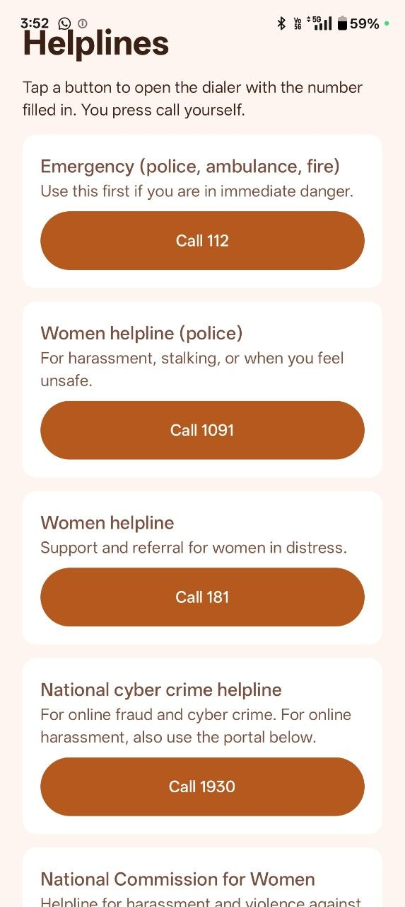
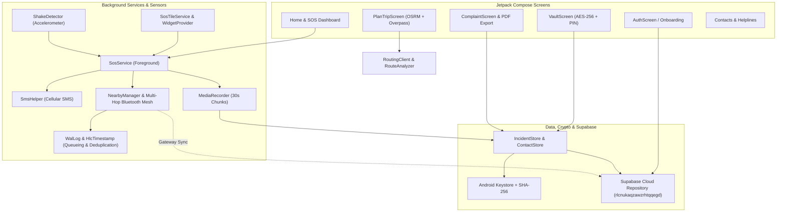

# SheShield SOS

> Her freedom should never come with fear.

SheShield SOS is an advanced, privacy-first women's safety platform for Android. It covers the complete safety lifecycle: **planning safer routes before travel, triggering silent SOS alerts during emergencies (with offline Bluetooth mesh and multi-hop relay capabilities), and preserving tamper-evident encrypted evidence and legal complaint generation afterwards.**

Built for **recHERsion 2026** (Women's Safety Problem Statement). Native Android, Kotlin, Jetpack Compose, Supabase cloud sync (`rlcnukaqzawzrhtqqegd`), and offline P2P Mesh networking.

---

## 🚨 Key Features

- **SOS Alerts:** Quickly send emergency alerts when feeling unsafe.
- **Cloud Sync:** Synchronize alerts and incidents through Supabase when internet is available (`rlcnukaqzawzrhtqqegd`).
- **SMS Fallback:** Send alerts through cellular networks when supported.
- **Bluetooth Mesh:** Relay emergency messages between nearby devices without requiring internet or a SIM on every device.
- **Multi-Hop Relay:** Forward SOS messages through participating devices across intermediate nodes.
- **Gateway Sync:** Forward offline alerts to Supabase through an internet-connected gateway device.
- **Alert Queueing:** Store pending alerts in a Write-Ahead Log (`WalLog`) until a communication path becomes available.
- **Duplicate Suppression:** Prevent repeated processing of the same message using Hybrid Logical Clocks (`HlcTimestamp`).
- **Safe-Route Planner:** OSRM & Overpass API route ranking based on lighting, commercial activity, police/hospitals, and crowdsourced community warnings.
- **Encrypted Evidence Vault:** AES-256-GCM file encryption backed by Android Keystore with SHA-256 integrity fingerprints, locked with a hashed 4-digit PIN.
- **Legal Complaint Builder:** Automated SHO complaint letter generator with embedded map links, evidence fingerprints, and PDF export (`ComplaintPdf`).
- **Widgets & Quick Tiles:** Home screen SOS AppWidget and Quick Settings tile for instant emergency activation.

---

## 📡 Three Communication Methods

### 1. ☁️ Cloud Synchronization
- Requires an internet connection.
- Sends emergency alerts and incident data to Supabase (`rlcnukaqzawzrhtqqegd`).
- Enables real-time synchronization with the configured emergency dashboard.

### 2. 📩 SMS Fallback
- Requires cellular coverage and a working SIM.
- Sends emergency messages and GPS location links through the mobile network.
- Useful when mobile data or Wi-Fi is unavailable but cellular SMS service works.

### 3. 🔵 Bluetooth Mesh & Multi-Hop Relay
- Requires Bluetooth and compatible nearby devices running the relay functionality (`NearbyManager`).
- Relays SOS messages between participating devices without requiring internet on every device.
- **Multi-Hop Relay:** Automatically forwards emergency messages through intermediate participating nodes.
- **Gateway Sync:** Forwards offline alerts toward an internet-connected gateway device, which synchronizes them with Supabase.
- **Queueing & Deduplication:** Queues pending messages in a Write-Ahead Log (`WalLog`) and suppresses duplicate transmissions via Hybrid Logical Clocks (`HlcTimestamp`).

---

## The Solution: Before, During, After

| Stage | What SheShield SOS does |
|---|---|
| **Before** | Explainable safe-route planner with OSRM & Overpass API. Ranks alternative routes (0-100 safety score), highlights street lighting, commercial activity, police/hospitals, and crowdsourced community warnings. |
| **During** | Silent SOS triggered via triple-shake detection, home screen widget, quick-settings tile, or SOS button. Broadcasts live GPS location via SMS every 60s, records encrypted audio chunks in the background, and coordinates via Bluetooth Mesh & Multi-Hop Relay when offline. |
| **After** | Encrypted Evidence Vault (AES-256-GCM backed by Android Keystore) with SHA-256 integrity fingerprints. Automated legal complaint builder exports ready-to-file PDF documents. |

---

## Screenshots

### Core App Features
| Home | After Triggering SOS | Plan a Safe Route | Evidence Vault |
|---|---|---|---|
|  |  |  |  |

| Ranked Routes & Warnings | Legal Complaint | Emergency Helplines |  |
|---|---|---|---|
|  |  |  ||

### Advanced Workflows & P2P Mesh
| SOS Alerts | P2P Multi-Hop Relay | P2P Emergency Resolution |
|---|---|---|---|---|
|  |  |  |

---

## Architecture



---

## Project Structure (`app/src/main/java/com/example/sheshield/`)

```
com/example/sheshield/
├── MainActivity.kt               # Main host activity
├── Navigation.kt                 # NavHost graph defining all Compose routes
├── SheShieldApp.kt               # Application class & cache initializers
├── data/
│   ├── CommunityReport.kt        # Crowdsourced warning data class
│   ├── ComplaintBuilder.kt       # Legal complaint text generator
│   ├── ComplaintPdf.kt           # PDF document exporter for legal complaints
│   ├── ContactStore.kt           # Local emergency contacts storage
│   ├── ContactsViewModel.kt      # Contacts state management
│   ├── Crypto.kt                 # AES-256-GCM encryption & Keystore management
│   ├── DemoPlaces.kt             # Demo locations for route planning
│   ├── IncidentStore.kt          # Encrypted incident storage
│   ├── OfflineSeed.kt            # Seed data for offline use
│   ├── OpenRouterClient.kt       # AI LLM helper client
│   ├── OverpassClient.kt         # OpenStreetMap Overpass API client
│   ├── ReportStore.kt            # Community reports repository
│   ├── RouteAnalyzer.kt          # Safety analyzer for route segments
│   ├── RouteContext.kt           # Route context data structures
│   ├── RouteModels.kt            # Route and location models
│   ├── RoutingClient.kt          # OSRM routing client
│   ├── SafetyScorer.kt           # Multi-factor safety scoring engine
│   ├── SosAlertStore.kt          # Active alerts store
│   ├── SosPrefs.kt               # SOS preferences & shake sensitivity
│   ├── SosState.kt               # SOS state machine definitions
│   ├── TripModels.kt             # Trip planning request models
│   ├── VaultLock.kt              # PIN verification & hashing
│   ├── p2p/                      # Offline mesh networking
│   │   ├── HlcTimestamp.kt       # Hybrid Logical Clocks for P2P sync
│   │   ├── MessageQueueManager.kt# P2P queue manager
│   │   ├── MessageTrustState.kt  # Trust state enum
│   │   ├── P2pMessage.kt         # P2p message data model
│   │   ├── PeerTrustStore.kt     # Peer trust management
│   │   └── WalLog.kt             # Write-Ahead Log for offline messages
│   └── supabase/                 # Cloud integration
│       ├── CloudRepository.kt    # Supabase data repository
│       ├── CloudSyncWorker.kt    # WorkManager for background sync
│       ├── SupabaseAuthManager.kt# Auth manager (signup/login)
│       └── SupabaseClient.kt     # Supabase client instance
├── service/
│   ├── NearbyManager.kt          # Nearby Connections P2P manager
│   ├── ShakeDetector.kt          # Accelerometer shake listener
│   ├── SmsBroadcastReceiver.kt   # SMS delivery broadcast receiver
│   ├── SmsHelper.kt              # SMS message dispatcher
│   ├── SosService.kt             # Foreground SOS alert service
│   └── SosTileService.kt         # Quick Settings tile for instant SOS
├── ui/
│   ├── AuthScreen.kt             # Supabase Authentication screen
│   ├── ComplaintScreen.kt        # Legal complaint generator UI
│   ├── ContactsScreen.kt         # Trusted contacts management UI
│   ├── HelplinesScreen.kt        # Emergency helplines directory UI
│   ├── OnboardingScreen.kt       # First-launch permission guide UI
│   ├── OsmMap.kt                 # osmdroid map wrapper component
│   ├── PlanTripScreen.kt         # Safe route planner UI
│   ├── SosAlertsScreen.kt        # Active SOS alerts & tracking UI
│   ├── TripExtras.kt             # Trip warnings and transport tips UI
│   ├── VaultScreen.kt            # PIN-locked encrypted evidence vault UI
│   └── theme/                    # Material 3 colors, typography, theme
└── widget/
    ├── SosWidgetProvider.kt      # Home screen SOS AppWidget
    └── WidgetTrampolineActivity.kt # Trampoline activity for widget action intents
```

---

## Tech Stack

- **UI & Architecture:** Kotlin, Jetpack Compose, Material 3, Navigation Compose, AndroidViewModel
- **Cloud & Auth:** Supabase (Project ID: `rlcnukaqzawzrhtqqegd`), WorkManager (`CloudSyncWorker`)
- **Offline Mesh:** Android Nearby Connections API, Write-Ahead Log (`WalLog`), Hybrid Logical Clocks (`HlcTimestamp`), Multi-Hop Relay
- **Security:** Android Keystore, AES-256-GCM encryption, SHA-256 fingerprinting, Salted PIN hashing
- **Sensors & Hardware:** Foreground Services, Accelerometer (`ShakeDetector`), `MediaRecorder`, `SmsManager`
- **Maps & Routing:** osmdroid, OSRM API, Overpass API
- **Minimum SDK:** API 26 (Android 8.0+)

---

## Setup & Running

1. Clone the repository and open in Android Studio.
2. Sync Gradle dependencies.
3. Connect a physical Android device (sensors, microphone, SMS, and Nearby Connections require real hardware).
4. Run the app and grant required permissions.

Built for **recHERsion 2026** (SheShield SOS).
