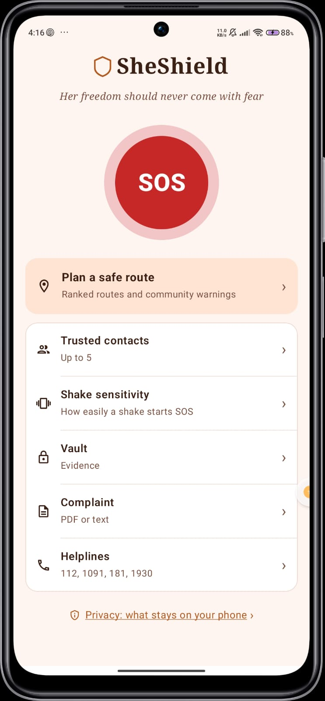
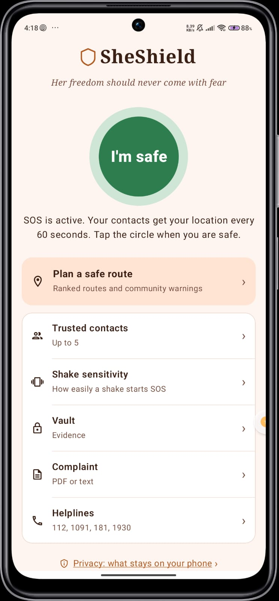
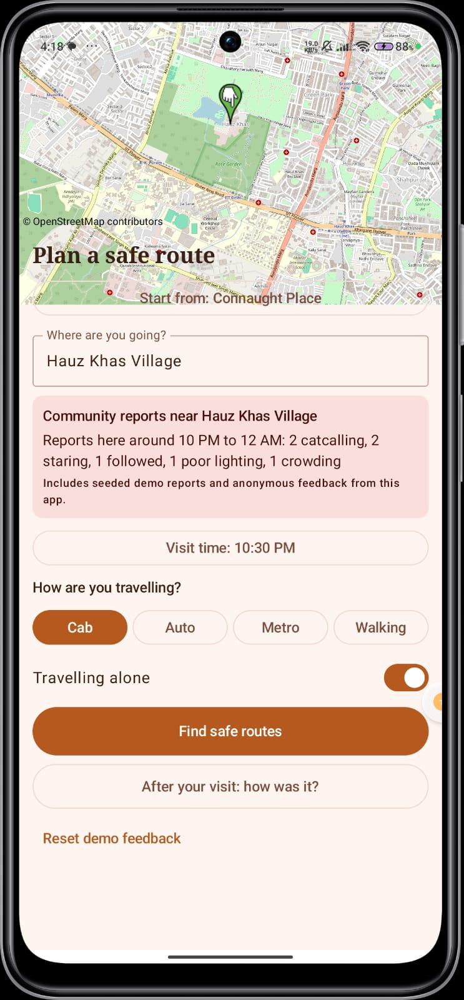
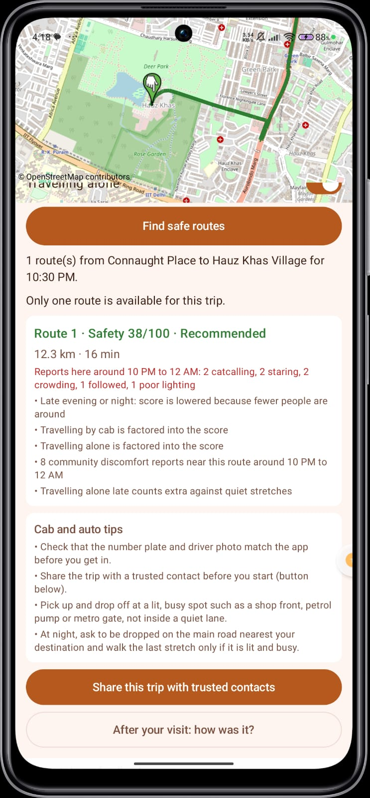
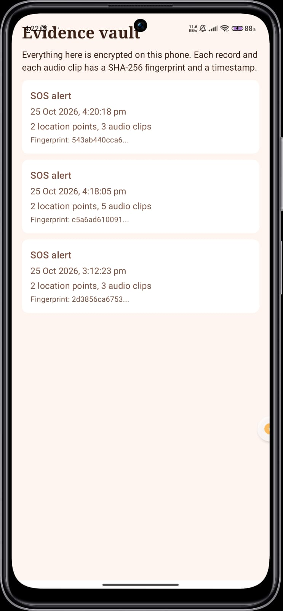
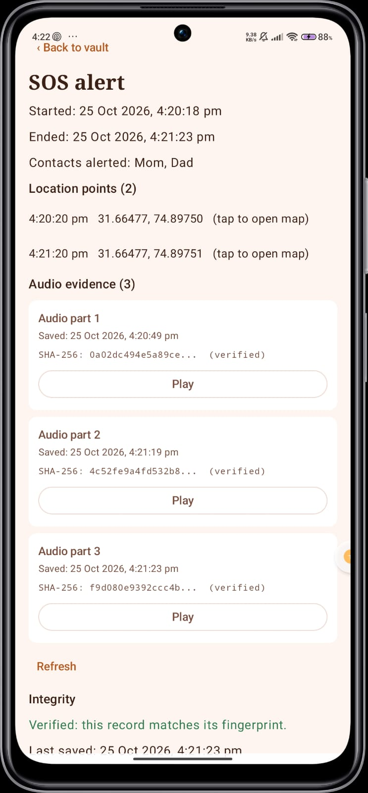
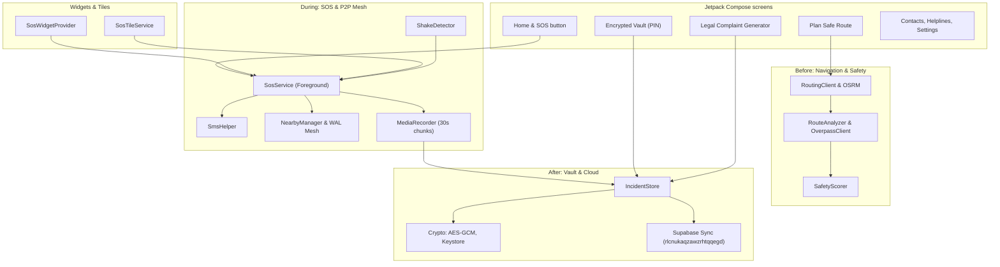

# SheShield SOS

> Her freedom should never come with fear.

SheShield SOS is an advanced, privacy-first women's safety platform for Android. It covers the complete safety lifecycle: **planning safer routes before travel, triggering silent SOS alerts during emergencies (with offline P2P mesh capability), and preserving tamper-evident encrypted evidence and legal complaint generation afterwards.**

Built for hackathons / **recHERsion** (Problem Statement: Women's Safety). Native Android, Kotlin, Jetpack Compose, Supabase cloud sync, and Offline P2P Mesh networking.

---
## The Problem

Safety tools often fail in real-world distress scenarios:
- Traditional navigation apps pick the fastest route, not the safest one, and lack contextual safety scoring.
- SOS apps frequently require active internet connections, an unlocked screen, or visible buttons.
- During cellular blackouts or remote travel, standard cloud alerts fail.
- Post-incident evidence is fragmented across device storage, and drafting legal complaints while traumatized is overwhelming.

## The Solution: Before, During, After

| Stage | What SheShield SOS does |
|---|---|
| **Before** | Explainable safe-route planner with OSRM & Overpass API. Ranks alternative routes (0-100 safety score), highlights street lighting, commercial activity, police/hospitals, and crowdsourced community warnings. |
| **During** | Silent SOS triggered via triple-shake detection, home screen widget, quick-settings tile, or SOS button. Broadcasts live GPS location via SMS every 60s, records encrypted audio chunks in the background, and coordinates with nearby devices via **P2P Mesh Network** if offline. |
| **After** | Encrypted Evidence Vault (AES-256-GCM backed by Android Keystore) with SHA-256 integrity fingerprints. Automated legal complaint builder exports ready-to-file PDF documents. |

---

## Screenshots

| Home | Plan a safe route | Ranked routes and warnings |
|---|---|---|
|  |  |  |

| SOS active | Evidence vault | Complaint |
|---|---|---|
|  |  |  |

---

## Key Features

### 1. Before: Safe-Route Planner & Warnings
- **OSM Map & OSRM Integration:** Select start points and destinations with alternative route ranking (Green = Recommended, Orange = Moderate, Red = Caution).
- **Safety Scorer:** Evaluates lighting data, shop density, police stations, hospitals, and isolated stretches.
- **Community Reports:** Crowdsourced discomfort warnings and post-visit feedback forms.

### 2. During: Silent SOS & P2P Mesh
- **Triggers:** Shake device 3 times, press the home screen SOS button, use the QuickSettings tile, or tap the Home Screen Widget.
- **Foreground Service & SMS:** Live Google Maps location updates sent to trusted contacts every 60 seconds via SMS.
- **Offline P2P Mesh (Nearby Connections & WAL):** When cellular network is unavailable, alerts and location pings are queued via a Write-Ahead Log (`WalLog`) and relayed peer-to-peer using Hybrid Logical Clocks (`HlcTimestamp`) and `NearbyManager`.
- **Audio Churn Recording:** Automatic 30-second audio chunk recording for verifiable event logs.

### 3. After: Encrypted Vault & Legal Complaint Generator
- **Encrypted Evidence Vault:** Protected by 4-digit PIN (salted hash) and AES-256-GCM encryption with SHA-256 fingerprints.
- **Complaint Builder & PDF Export:** Auto-generates official legal complaints addressed to the SHO with embedded location links and evidence fingerprints.
- **Emergency Helplines:** One-tap calling for 112, 1091, 181, and cybercrime (1930).

### 4. Backend & Cloud Sync (Supabase)
- **Supabase Integration:** Secure authentication (`SupabaseAuthManager`) and cloud synchronization (`CloudRepository`, `CloudSyncWorker`) using Project ID: `rlcnukaqzawzrhtqqegd`.

---

## Architecture



---

## Project Structure

```
app/src/main/java/com/example/sheshield/
  MainActivity.kt, Navigation.kt      # App entry point and navigation graph
  SheShieldApp.kt                     # Application container & caches
  data/
    ContactStore, ContactsViewModel   # Trusted contacts management
    SosState, SosPrefs                # SOS state & shake sensitivity
    IncidentStore, Crypto, VaultLock  # AES-256 encryption & PIN vault
    ComplaintBuilder, ComplaintPdf    # Legal complaint generator & PDF export
    RoutingClient, RouteAnalyzer      # OSRM routing & Overpass safety analysis
    SafetyScorer                      # Multi-factor safety algorithm
    p2p/                              # Offline mesh networking (WAL, HLC, NearbyManager)
    supabase/                         # Cloud sync, Auth Manager, and SyncWorker
  service/
    SosService, ShakeDetector, SmsHelper # Foreground SOS & sensor triggers
    SosTileService, NearbyManager        # Quick Settings tile & P2P manager
  ui/
    OsmMap, PlanTripScreen, VaultScreen, ComplaintScreen, AuthScreen...
  widget/
    SosWidgetProvider, WidgetTrampolineActivity # Home screen widgets
```

---

## Tech Stack & Configuration

- **Language & UI:** Kotlin, Jetpack Compose, Material 3, Navigation Compose
- **Cloud & Auth:** Supabase (Project ID: `rlcnukaqzawzrhtqqegd`)
- **Offline Mesh:** Android Nearby Connections API, Write-Ahead Log (`WalLog`), Hybrid Logical Clocks (`HlcTimestamp`)
- **Security:** Android Keystore (AES-256-GCM), SHA-256 hashing, PIN hashing
- **Maps & Routing:** osmdroid (OpenStreetMap), OSRM routing API, Overpass API
- **Sensors & Services:** Foreground Services, Accelerometer (`ShakeDetector`), `MediaRecorder`, `SmsManager`
- **Minimum SDK:** API 26 (Android 8.0+)

---

## Setup & Running

1. Clone the repository and open in Android Studio (supporting SDK 37).
2. Sync project with Gradle files.
3. Connect a physical Android device (sensors, microphone, SMS, and Nearby Connections do not function fully on emulators).
4. Run the app, grant requested permissions (Location, SMS, Microphone, Notifications), and add trusted contacts.

---

## Credits

- Map Data: © OpenStreetMap contributors (ODbL)
- Routing Engine: OSRM
- Safety Context: Overpass API
- Map Rendering: osmdroid

Built for **recHERsion 2026** (SheShield SOS).
