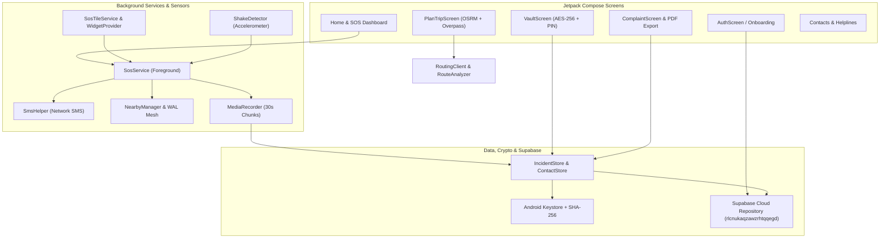

# SheShield SOS

> Her freedom should never come with fear.

SheShield SOS is an advanced, privacy-first women's safety platform for Android. It covers the complete safety lifecycle: **planning safer routes before travel, triggering silent SOS alerts during emergencies (with offline P2P mesh capability), and preserving tamper-evident encrypted evidence and legal complaint generation afterwards.**

Built for **recHERsion 2026** (Women's Safety Problem Statement). Native Android, Kotlin, Jetpack Compose, Supabase cloud sync (`rlcnukaqzawzrhtqqegd`), and Offline P2P Mesh networking.

---

## Complete Feature Directory & App Screens

| Screen / Feature | Component / File | Description |
|---|---|---|
| **Authentication** | [`AuthScreen.kt`](file:///app/src/main/java/com/example/sheshield/ui/AuthScreen.kt), [`SupabaseAuthManager.kt`](file:///app/src/main/java/com/example/sheshield/data/supabase/SupabaseAuthManager.kt) | Secure login & sign-up via Supabase backend (Project ID: `rlcnukaqzawzrhtqqegd`). |
| **Onboarding** | [`OnboardingScreen.kt`](file:///app/src/main/java/com/example/sheshield/ui/OnboardingScreen.kt) | First-launch guide explaining critical permissions (Location, SMS, Microphone, Notifications). |
| **Home Dashboard** | [`MainActivity.kt`](file:///app/src/main/java/com/example/sheshield/MainActivity.kt), [`SheShieldApp.kt`](file:///app/src/main/java/com/example/sheshield/SheShieldApp.kt) | Central hub with quick access to SOS, route planning, vault, complaints, and helplines. |
| **Trip Planner & Routing** | [`PlanTripScreen.kt`](file:///app/src/main/java/com/example/sheshield/ui/PlanTripScreen.kt), [`RoutingClient.kt`](file:///app/src/main/java/com/example/sheshield/data/RoutingClient.kt) | OSRM route selection, safety scoring (0-100), transport mode selection (cab, auto, metro, walking), and traveling-alone state. |
| **Safety Analyzer** | [`RouteAnalyzer.kt`](file:///app/src/main/java/com/example/sheshield/data/RouteAnalyzer.kt), [`SafetyScorer.kt`](file:///app/src/main/java/com/example/sheshield/data/SafetyScorer.kt) | Evaluates street lighting, commercial activity, police/hospitals, isolated stretches, and community reports. |
| **Silent SOS & Sensors** | [`SosService.kt`](file:///app/src/main/java/com/example/sheshield/service/SosService.kt), [`ShakeDetector.kt`](file:///app/src/main/java/com/example/sheshield/service/ShakeDetector.kt) | Foreground service triggered via 3x shake, SOS button, widget, or quick settings tile. Sends SMS updates every 60s with live Google Maps link. |
| **Audio Churn Recorder** | [`SosService.kt`](file:///app/src/main/java/com/example/sheshield/service/SosService.kt) | Automatic background 30-second audio chunk recording during active SOS. |
| **P2P Mesh Network** | [`NearbyManager.kt`](file:///app/src/main/java/com/example/sheshield/service/NearbyManager.kt), [`WalLog.kt`](file:///app/src/main/java/com/example/sheshield/data/p2p/WalLog.kt) | Offline peer-to-peer message relaying using Write-Ahead Log and Hybrid Logical Clocks (`HlcTimestamp`) during cellular blackouts. |
| **Active SOS Alerts** | [`SosAlertsScreen.kt`](file:///app/src/main/java/com/example/sheshield/ui/SosAlertsScreen.kt), [`IncidentStore.kt`](file:///app/src/main/java/com/example/sheshield/data/IncidentStore.kt) | Live tracking of emergency triggers, active alerts, and incident history logs. |
| **Encrypted Evidence Vault** | [`VaultScreen.kt`](file:///app/src/main/java/com/example/sheshield/ui/VaultScreen.kt), [`Crypto.kt`](file:///app/src/main/java/com/example/sheshield/data/Crypto.kt) | PIN-protected AES-256-GCM file encryption backed by Android Keystore with SHA-256 integrity fingerprints. |
| **Legal Complaint Builder** | [`ComplaintScreen.kt`](file:///app/src/main/java/com/example/sheshield/ui/ComplaintScreen.kt), [`ComplaintPdf.kt`](file:///app/src/main/java/com/example/sheshield/data/ComplaintPdf.kt) | Automated SHO complaint letter generator with embedded location points, evidence fingerprints, and PDF export. |
| **Emergency Helplines** | [`HelplinesScreen.kt`](file:///app/src/main/java/com/example/sheshield/ui/HelplinesScreen.kt) | One-tap dialing for 112 (Emergency), 1091 (Women Helpline), 181 (Domestic Abuse), and 1930 (Cybercrime). |
| **Trusted Contacts** | [`ContactsScreen.kt`](file:///app/src/main/java/com/example/sheshield/ui/ContactsScreen.kt), [`ContactStore.kt`](file:///app/src/main/java/com/example/sheshield/data/ContactStore.kt) | Managing up to 5 emergency SMS contacts. |
| **Cloud Sync Worker** | [`CloudSyncWorker.kt`](file:///app/src/main/java/com/example/sheshield/data/supabase/CloudSyncWorker.kt), [`CloudRepository.kt`](file:///app/src/main/java/com/example/sheshield/data/supabase/CloudRepository.kt) | Background synchronization with Supabase backend (`rlcnukaqzawzrhtqqegd`). |
| **Widgets & Quick Tiles** | [`SosWidgetProvider.kt`](file:///app/src/main/java/com/example/sheshield/widget/SosWidgetProvider.kt), [`SosTileService.kt`](file:///app/src/main/java/com/example/sheshield/service/SosTileService.kt) | Home screen SOS app widget and Quick Settings tile for instant emergency activation. |

---

## Screenshots

| Home | Plan a safe route | Ranked routes and warnings |
|---|---|---|
|  |  |  |

| SOS active | Evidence vault | Complaint |
|---|---|---|
|  |  |  |

---

## Architecture



---

## Project Structure (`app/src/main/java/com/example/sheshield/`)

```
com/example/sheshield/
├── MainActivity.kt               # Main host activity
├── Navigation.kt                 # NavHost graph defining all Compose routes
├── SheShieldApp.kt               # Application class & cache initializers
├── data/
│   ├── CommunityReport.kt        # Crowdsourced warning data class
│   ├── ComplaintBuilder.kt       # Legal complaint text generator
│   ├── ComplaintPdf.kt           # PDF document exporter for legal complaints
│   ├── ContactStore.kt           # Local emergency contacts storage
│   ├── ContactsViewModel.kt      # Contacts state management
│   ├── Crypto.kt                 # AES-256-GCM encryption & Keystore management
│   ├── DemoPlaces.kt             # Demo locations for route planning
│   ├── IncidentStore.kt          # Encrypted incident storage
│   ├── OfflineSeed.kt            # Seed data for offline use
│   ├── OpenRouterClient.kt       # AI LLM helper client
│   ├── OverpassClient.kt         # OpenStreetMap Overpass API client
│   ├── ReportStore.kt            # Community reports repository
│   ├── RouteAnalyzer.kt          # Safety analyzer for route segments
│   ├── RouteContext.kt           # Route context data structures
│   ├── RouteModels.kt            # Route and location models
│   ├── RoutingClient.kt          # OSRM routing client
│   ├── SafetyScorer.kt           # Multi-factor safety scoring engine
│   ├── SosAlertStore.kt          # Active alerts store
│   ├── SosPrefs.kt               # SOS preferences & shake sensitivity
│   ├── SosState.kt               # SOS state machine definitions
│   ├── TripModels.kt             # Trip planning request models
│   ├── VaultLock.kt              # PIN verification & hashing
│   ├── p2p/                      # Offline mesh networking
│   │   ├── HlcTimestamp.kt       # Hybrid Logical Clocks for P2P sync
│   │   ├── MessageQueueManager.kt# P2P queue manager
│   │   ├── MessageTrustState.kt  # Trust state enum
│   │   ├── P2pMessage.kt         # P2P message data model
│   │   ├── PeerTrustStore.kt     # Peer trust management
│   │   └── WalLog.kt             # Write-Ahead Log for offline messages
│   └── supabase/                 # Cloud integration
│       ├── CloudRepository.kt    # Supabase data repository
│       ├── CloudSyncWorker.kt    # WorkManager for background sync
│       ├── SupabaseAuthManager.kt# Auth manager (signup/login)
│       └── SupabaseClient.kt     # Supabase client instance
├── service/
│   ├── NearbyManager.kt          # Nearby Connections P2P manager
│   ├── ShakeDetector.kt          # Accelerometer shake listener
│   ├── SmsBroadcastReceiver.kt   # SMS delivery broadcast receiver
│   ├── SmsHelper.kt              # SMS message dispatcher
│   ├── SosService.kt             # Foreground SOS alert service
│   └── SosTileService.kt         # Quick Settings tile for instant SOS
├── ui/
│   ├── AuthScreen.kt             # Supabase Authentication screen
│   ├── ComplaintScreen.kt        # Legal complaint generator UI
│   ├── ContactsScreen.kt         # Trusted contacts management UI
│   ├── HelplinesScreen.kt        # Emergency helplines directory UI
│   ├── OnboardingScreen.kt       # First-launch permission guide UI
│   ├── OsmMap.kt                 # osmdroid map wrapper component
│   ├── PlanTripScreen.kt         # Safe route planner UI
│   ├── SosAlertsScreen.kt        # Active SOS alerts & tracking UI
│   ├── TripExtras.kt             # Trip warnings and transport tips UI
│   ├── VaultScreen.kt            # PIN-locked encrypted evidence vault UI
│   └── theme/                    # Material 3 colors, typography, theme
└── widget/
    ├── SosWidgetProvider.kt      # Home screen SOS AppWidget
    └── WidgetTrampolineActivity.kt # Trampoline activity for widget action intents
```

---

## Tech Stack

- **UI & Architecture:** Kotlin, Jetpack Compose, Material 3, Navigation Compose, AndroidViewModel
- **Cloud & Auth:** Supabase (Project ID: `rlcnukaqzawzrhtqqegd`), WorkManager (`CloudSyncWorker`)
- **Offline Mesh:** Android Nearby Connections API, Write-Ahead Log (`WalLog`), Hybrid Logical Clocks (`HlcTimestamp`)
- **Security:** Android Keystore, AES-256-GCM encryption, SHA-256 fingerprinting, Salted PIN hashing
- **Sensors & Hardware:** Foreground Services, Accelerometer (`ShakeDetector`), `MediaRecorder`, `SmsManager`
- **Maps & Routing:** osmdroid, OSRM API, Overpass API
- **Minimum SDK:** API 26 (Android 8.0+)

---

## Setup & Running

1. Clone the repository and open in Android Studio.
2. Sync Gradle dependencies.
3. Connect a physical Android device (sensors, microphone, SMS, and Nearby Connections require real hardware).
4. Run the app and grant required permissions.

Built for **recHERsion 2026** (SheShield SOS).
